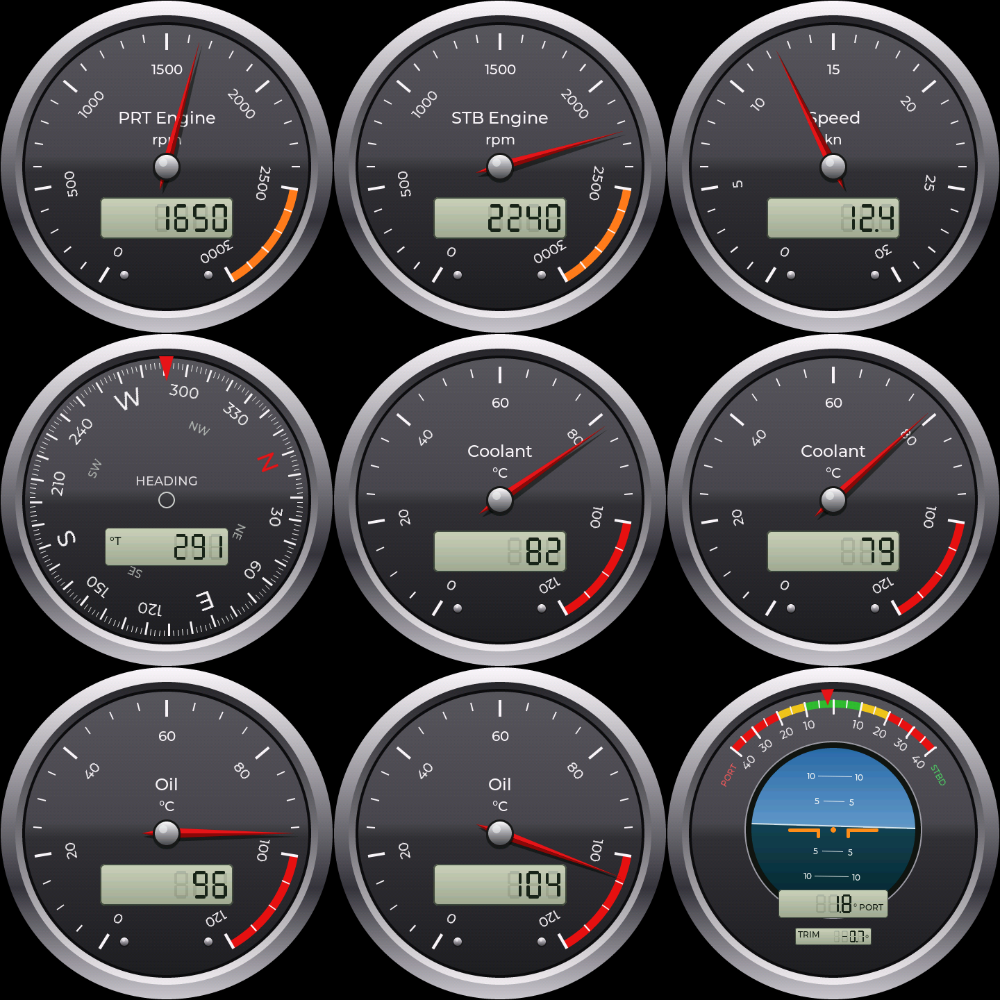

# signalk-esp32-gauges

Classic steel-style Signal K instrument gauges for Waveshare round touch
displays. Each unit shows one gauge at a time — engine rpm, speed, heading,
coolant and oil temperature, and a sea-horizon heel/trim indicator — and you
swipe between them. Data comes from a Signal K server through
[SensESP](https://github.com/SignalK/SensESP); the look follows the
"Classic Steel" gauges of [SKIP](https://github.com/halos-org/skip).



*All pages with sample values, rendered on a PC by
[`tools/preview`](tools/preview/) from the firmware's own drawing code.*

| Folder | Hardware | Display |
|---|---|---|
| [`waveshare-esp32-p4-wifi6-touch-lcd-4c/`](waveshare-esp32-p4-wifi6-touch-lcd-4c/) | Waveshare **ESP32-P4-WIFI6-Touch-LCD-4C** (SKU 31522) | 4" round 720×720, MIPI-DSI |
| [`waveshare-esp32-s3-touch-lcd-2.1/`](waveshare-esp32-s3-touch-lcd-2.1/) | Waveshare **ESP32-S3-Touch-LCD-2.1** (SKU 28169) | 2.1" round 480×480, RGB |
| [`common/`](common/) | Shared library: gauge pages, Signal K data, LVGL port | — |
| [`tools/preview/`](tools/preview/) | Renders the gauge pages on a PC | — |

Each hardware folder is its own PlatformIO project. Both build the same gauge
code from `common/`, scaled to the panel's size.

## The four units

| Unit | Side | Address | Project | OTA env | First flash (USB) |
|---|---|---|---|---|---|
| 4" #1 | starboard | 192.168.220.130 | `waveshare-esp32-p4-wifi6-touch-lcd-4c` | `p4_stbd` | `p4_stbd_usb` |
| 4" #2 | port | 192.168.220.131 | `waveshare-esp32-p4-wifi6-touch-lcd-4c` | `p4_port` | `p4_port_usb` |
| 2.1" #1 | starboard | 192.168.220.132 | `waveshare-esp32-s3-touch-lcd-2.1` | `s3_stbd` | `s3_stbd_usb` |
| 2.1" #2 | port | 192.168.220.133 | `waveshare-esp32-s3-touch-lcd-2.1` | `s3_port` | `s3_port_usb` |

A unit's side decides which engine it shows. Heading, speed and the sea horizon
are on every unit:

| Port units swipe through | Starboard units swipe through |
|---|---|
| PRT Engine rpm | STB Engine rpm |
| Speed | Speed |
| Heading | Heading |
| Coolant (port) | Coolant (starboard) |
| Oil (port) | Oil (starboard) |
| Sea horizon (heel / trim) | Sea horizon (heel / trim) |

## Gauges

| Page | Default Signal K path | Shown as | Range |
|---|---|---|---|
| PRT / STB Engine | `propulsion.<port\|starboard>.revolutions` (Hz) | rpm | 0–3000, orange from 2500 |
| Speed | `navigation.speedOverGround` (m/s) | kn | 0–30 |
| Heading | `navigation.headingTrue` (rad) | °T, rotating card | 0–360 |
| Coolant | `propulsion.<side>.coolantTemperature` (K) | °C | 0–120, red from 100 |
| Oil | `propulsion.<side>.oilTemperature` (K) | °C | 0–120, red from 100 |
| Sea horizon | `navigation.attitude` (`roll`, `pitch`, rad) | boat symbol on a level horizon; heel ° PORT/STBD, trim ° | heel ±40 |

Every path can be changed per unit in the SensESP web UI: on the
**Configuration** page, in the card for that gauge (for example
"PRT Engine (port_rpm)"), then restart the unit.

The gauges never show a number nobody vouches for:

- A value that is not a number (for example `null` from a source that has
  lost its data) blanks the gauge at once instead of being shown as 0.
- A value older than 10 s is shown as dashes. A dial needle parks at its
  minimum, the compass card stays where it was but dimmed, and the sea
  horizon's boat symbol levels off, dimmed.
- After every (re)connect to Signal K the first value of each path is
  ignored: the server replays the last value it holds, however old.

To change ranges, zones, titles or the page order, edit the table in
[`common/src/gauge_defs.cpp`](common/src/gauge_defs.cpp).

## Touch

- **Swipe left / right**: next / previous gauge (wraps around).
- **Tap**: info box with the unit, its IP address, the Signal K connection
  and the Signal K path the current page listens to. Tap again to close it.
- **Long press**: backlight 100 → 60 → 30 → 10 %.

The page and brightness are remembered across restarts. If the touch
controller does not start, the unit restarts and tries again (on the 4" with
the GT911's other address), and after that runs without touch rather than
not at all: it keeps showing the remembered page until the next power-up.

The small dot at the
bottom of the bezel is SensESP's status LED: its colour and blink pattern show
the WiFi and Signal K state, and it shows blue, with a brief blink each
second, when connected.

## Setup

1. Install [PlatformIO](https://platformio.org/install) (VS Code extension or
   `pip install platformio`).
2. Copy `include/secrets.example.h` to `include/secrets.h` and fill in the WiFi,
   the Signal K server, an OTA password (letters, digits and
   `. _ ~ + = @ : , / -` only: it goes on a shell command line) and a web UI
   admin password.
   `secrets.h` is gitignored; it is shared by both projects and by the OTA
   upload script. The four unit addresses are already filled in. Set
   `SECRET_USE_STATIC_IP` to `1` if you want each unit to configure its address
   statically instead of using DHCP reservations. These values only seed a
   unit with no saved settings: once WiFi or the Signal K server has been
   saved on the unit, its saved values win.
3. First flash of each unit over USB, for example 4" #1:

   ```bash
   cd waveshare-esp32-p4-wifi6-touch-lcd-4c
   ```

   ```bash
   pio run -e p4_stbd_usb -t upload
   ```

4. In the Signal K server admin UI, approve the unit's access request
   (**Security → Access Requests**; the unit is named after its hostname, e.g.
   `gauge-4c-stbd`). Read access is enough.
5. After that, update over WiFi:

   ```bash
   pio run -e p4_stbd -t upload
   ```

   `scripts/ota_auth.py` (adapted from
   [drive-remote-controller](https://github.com/KEGustafsson/drive-remote-controller))
   takes the OTA password and the unit's address from `include/secrets.h`, so
   neither is written into `platformio.ini`; `scripts/ota_quiet.py` keeps
   espota from echoing the password into the upload log.

SensESP's setup access point (named after the unit's hostname) follows
`secrets.h`: with `SECRET_AP_PASSWORD` set it uses that password; with the
boat's WiFi set and no AP password it is off; with nothing configured it
comes up with SensESP's default password `thisisfine`, so a unit flashed
without a `secrets.h` can be set up from the web UI at `192.168.4.1`. With
`SECRET_ADMIN_PASSWORD` set, the web UI asks for that login on the boat's
network (the unit restarts once after the login changes, to apply it);
requests over the setup access point are not asked to log in, so there the
access point password is the protection.

The units also reboot rather than freeze: the main loop runs under a 5 s
watchdog (paused during OTA uploads), and a failed display start or a stuck
screen update restarts the unit.

## How it is built

- **Display and touch**: [ESP32_Display_Panel](https://github.com/esp-arduino-libs/ESP32_Display_Panel),
  Espressif's driver library that Waveshare's own Arduino examples use. The
  2.1" uses its built-in board file; the 4" uses a custom board file made from
  Waveshare's ESP-IDF BSP and Arduino examples.
- **Graphics**: LVGL 9.3. The static dial face (chrome bezel, scale, numbers)
  is drawn once into a canvas, including the sea horizon, which is always
  level; only the needle, compass card, boat symbol, heel pointer and LCD
  readouts are redrawn as values change.
- **Data**: SensESP (main branch) subscribes to the Signal K paths over WebSocket. SensESP
  and LVGL run on the same Arduino loop task, so they share data without locks.
- **Framework**: Arduino-ESP32 3.3.11 through the pioarduino platform.

## Status

The firmware compiles for both boards, but it has not yet been run on the
hardware. CI ([`.github/workflows/ci.yml`](.github/workflows/ci.yml)) builds both
boards (as their starboard units), renders every gauge page on the host, and checks that no credential
is committed, on every pull request and every push to `main`. Working rules for contributors
(and AI agents) are in [AGENTS.md](AGENTS.md). Things to check on first power-up are listed in each board folder's
README.
